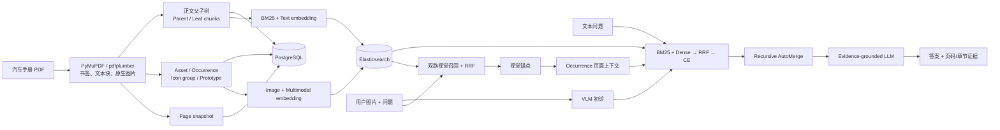

# AutoRAG：基于多模态 RAG 的汽车手册问答系统

AutoRAG 面向结构化、图文混排的汽车用户手册，支持上传 PDF 建库、文本问答和图片问答。系统先在当前手册中定位正文或视觉对象，再依据检索证据生成回答；目标不是让模型凭常识猜测，而是让回答可以追溯到具体章节和页码。

> 当前版本是固定编排的 RAG workflow，不是自主 Agent，也没有训练或微调基础模型。

## 项目亮点

- **书签父子 Chunk + AutoMerge**：使用 PyMuPDF 读取 PDF 书签、跳转位置和有序文本块，构建正文树；只检索不超过 500 tokens 的叶子，命中多个兄弟节点时递归恢复父章节，并受 1,800-token 父节点上限和 5,000-token 总证据预算约束。
- **混合检索与重排**：文本链路采用 BM25 Top20、Dense Top20、加权 RRF 和 Cross-Encoder；完整书签路径与正文共同参与关键词、向量和重排。
- **Group–Occurrence 视觉索引**：同一图标可能在手册中出现多次。系统通过原生 PDF 图片资产、主颜色、pHash、图片向量和 VLM 建立 icon group；group 负责视觉身份，occurrence 保留每次出现的页码、位置和局部上下文。
- **双路视觉召回**：图片向量与多模态向量独立召回后，以 RRF 融合确定视觉锚点。OpenCV 与候选改选式 VLM 经消融为负增益，未进入默认在线排序。
- **视觉锚点后的正文 RAG**：图片匹配只解决“这是什么”；系统再使用图标标准名称、VLM 初诊和所有 occurrence 页定位正文，经文本混合检索与重排回答“含义、条件和处理方法”。
- **分层评测**：分别评价叶子检索、AutoMerge 后必答点覆盖、视觉对象命中和最终答案，避免用一个端到端分数掩盖错误发生在哪一层。

## 系统架构



### 数据职责

| 存储 | 保存内容 | 原因 |
|---|---|---|
| PostgreSQL | 手册、页面、全部 Chunk、正文父子关系、图片 asset、occurrence、icon group、prototype | 保存完整业务结构和可追溯关系 |
| Elasticsearch | 可直接检索的正文叶子、视觉原型及文本/图片/多模态向量 | 提供 BM25、ANN 向量检索和过滤 |
| 本地存储 | 原 PDF、页面截图、原生图片资产、查询图片 | 保存模型调用和证据展示需要的二进制文件 |

## 两条问答链路

### 文本问答

```text
问题与领域词扩展
  → BM25 Top20 + Dense Top20
  → 加权 RRF 候选融合
  → Cross-Encoder 重排
  → Recursive AutoMerge
  → token budget
  → LLM 基于正文证据流式回答
```

父 Chunk 保存在 PostgreSQL，不直接进入 Elasticsearch；这样细节题使用小粒度叶子，汇总题在满足覆盖阈值时才恢复完整父章节。

### 图片问答

```text
用户图片 + 问题
  → VLM 初诊（描述/OCR/query 辅助信息）
  → 白底图片向量 Top20 + 多模态向量 Top20
  → 按 icon_group_id / visual_chunk_id 去重
  → 双路 RRF，取 Top1 视觉锚点
  → group 全部 occurrence 页 + object_name + VLM 初诊构造正文 query
  → BM25 + Dense + RRF + Cross-Encoder + AutoMerge
  → 1 条视觉证据 + 最多 4 条正文证据
  → LLM 生成回答
```

## 实验结果

评测结果如下；指标定义、样本量和完整消融见 [Eval.md](Eval.md)。

| 模块 | 结果 |
|---|---|
| 文本检索 | Cross-Encoder 相比 Weighted RRF 将 Leaf Hit@1 从 **66% 提升到 86%**，Leaf Hit@5 从 **90% 提升到 98%**；Leaf-group Recall@3/@5 为 **95%/98%** |
| 文本上下文与回答 | 最终必答点完整覆盖率 **96%**；50 条可回答题的 GPT-5.6 Judge Answer Correctness 为 **97.2%** |
| 图标索引压缩 | 将 **377** 次 icon occurrence 聚合为 **164** 个 group，在线候选身份减少 **56.5%** |
| 视觉召回 | 70 条可回答视觉样本中，双路 RRF 将 Hit@1 从 **92.86% 提升到 95.71%**；Hit@5 为 **100%** |
| 图片端到端 | 正文必答点完整覆盖率 **86.96%**，Answer Correctness **93.14%**，Groundedness **98.43%** |

## 目录结构

```text
AutoRAG/
├── backend/
│   ├── app/
│   │   ├── router/          # FastAPI 接口
│   │   ├── service/         # 建库、检索、重排、视觉分组与回答生成
│   │   ├── models/          # SQLAlchemy 数据模型
│   │   ├── schemas/         # 请求与响应模型
│   │   ├── tests/           # 后端回归测试
│   │   └── evaluate_owner_manual.py
│   ├── docker-compose.yml
│   └── .env.example
├── frontend/                # React + TypeScript + Vite + Ant Design
├── evals/
│   ├── datasets/            # 文本/图片 JSONL 与图片样本
│   ├── scripts/             # 评测与报告生成代码
│   └── results/             # 评测结果汇总
├── Eval.md                  # 指标定义、消融实验和结果边界
└── README.md
```

## 快速启动

### 1. 环境要求

- Docker 与 Docker Compose
- Node.js 18+
- 可调用的 OpenAI-compatible LLM、文本 Embedding、图片 Embedding、多模态 Embedding、VLM 和 Reranker 服务

### 2. 配置并启动后端

```bash
git clone https://github.com/zaxon-b/AutoRAG.git
cd AutoRAG/backend
cp .env.example .env
```

在 `.env` 中填写至少以下密钥：

```text
LLM_API_KEY=
DASHSCOPE_API_KEY=
VLM_API_KEY=
```

启动 FastAPI、PostgreSQL 和 Elasticsearch：

```bash
docker compose up -d --build
docker compose logs -f autorag_api
```

### 3. 启动前端

```bash
cd ../frontend
npm ci
npm run dev
```

- 前端：`http://localhost:5181`
- 后端：`http://localhost:8000`
- OpenAPI：`http://localhost:8000/docs`
- 健康检查：`http://localhost:8000/health`

首次使用时在页面上传 PDF。当前建库接口为同步长请求，图片较多的手册可能需要较长时间完成向量生成与索引写入。

## API

| 方法 | 路径 | 作用 |
|---|---|---|
| `GET` | `/health` | 服务健康检查 |
| `GET` | `/manuals/status` | 查询当前手册建库状态 |
| `POST` | `/manuals/upload` | 上传 PDF 并执行完整建库 |
| `POST` | `/qa/text` | 文本问答，SSE 流式返回 |
| `POST` | `/qa/image` | 图片问答，返回视觉与正文证据 |

## 评测与测试

数据集位于 `evals/datasets/`，评测汇总位于 `evals/results/`。逐题审计和原始模型输出不随仓库分发。

```bash
cd backend

# 文本检索/生成评测
docker compose exec -T autorag_api \
  python -m evaluate_owner_manual --mode text --latest-only

# 图片链路评测
docker compose exec -T autorag_api \
  python -m evaluate_owner_manual --mode image --latest-only

# 后端单元与回归测试
docker compose exec -T autorag_api \
  python -m unittest discover -s tests -p 'test_*.py'
```

前端构建检查：

```bash
cd frontend
npm run build
```

## 数据说明与限制

- 仓库公开评测 JSONL 和配套图片样本；原始汽车手册 PDF 涉及版权，不随仓库分发，请使用有权处理的 PDF 自行建库。
- `.env`、本地数据库、Elasticsearch 数据卷、运行时图片和查询日志均被忽略。
- 当前是单手册 Demo，建库仍为同步执行；生产化还需要任务队列、阶段进度、鉴权、限流、对象存储和监控。
- 500-token 叶子、0.5 AutoMerge 比例等超参数来自当前数据集实验，迁移到其他手册时应重新评估。
- 视觉二验、OpenCV 权重和拒答阈值均应以独立验证集调参，不能只在测试集上选择。

